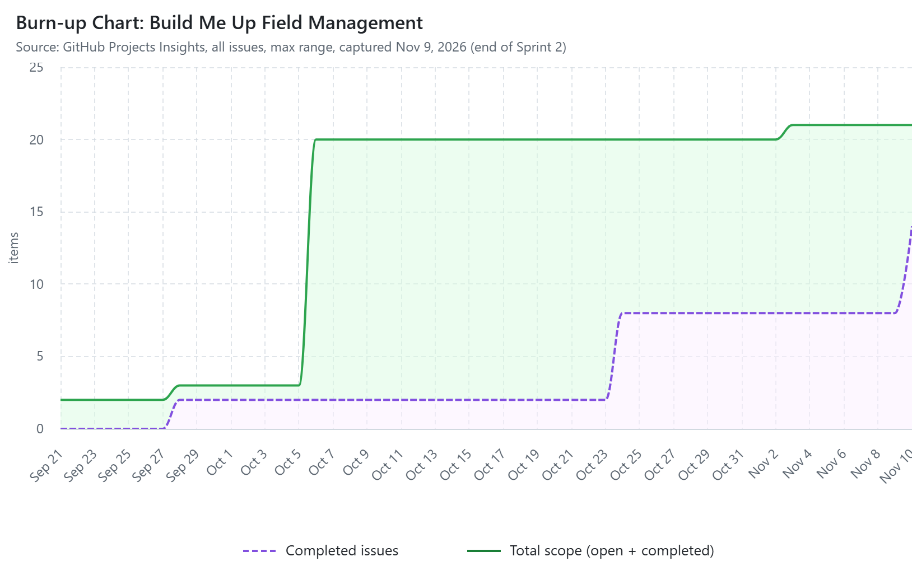

# Metrics & EVM Report: Build Me Up Field Management

**Project:** Field Operations & Change Management Portal
**Reporting point:** End of Sprint 2 (Nov 8, 2026)
**Prepared:** Nov 9, 2026
**Data source:** GitHub Projects board, Story Points and Sprint fields, Insights burn-up chart

---

## 1. Velocity & Burn-Up Performance Analysis

### 1.1 Sprint Velocity

| Sprint | Dates | Issues Committed | Issues Completed | Story Points Committed | Story Points Completed | Commitment Met |
|---|---|---|---|---|---|---|
| Sprint 1: Foundation & Field Capture | Oct 12 – Oct 25 | 6 | 6 | 34 | 34 | 100% |
| Sprint 2: Core Workflows | Oct 26 – Nov 8 | 6 | 6 | 37 | 37 | 100% |
| **Total to date** | | **12** | **12** | **71** | **71** | **100%** |
| Sprint 3: Drawings, Reporting & Integration (planned) | Nov 9 – Nov 22 | 6 | – | 34 | – | – |

**Story points by issue**

| Sprint | Issues (story points) |
|---|---|
| Sprint 1 | #4 Role-based auth (8), #6 Mobile daily site logs (8), #3 Cloud infrastructure (5), #10 Field change requests (5), #13 Safety incident reporting (5), #5 Project/job-site setup (3) |
| Sprint 2 | #7 Offline mode & sync (8), #11 Change order approval workflow (8), #15 Real-time dashboard (8), #12 Change orders linked to budget (5), #16 Notifications & activity feed (5), #14 Safety corrective actions (3) |
| Sprint 3 | #8 Blueprint viewer & markup (8), #19 Accounting integration (8), #9 Blueprint revision control (5), #17 Global search (5), #20 Audit trail & data retention (5), #18 Exportable reports (3) |

### 1.2 Velocity Trend

- **Sprint 1 velocity:** 34 points
- **Sprint 2 velocity:** 37 points (**+3 points, +8.8%** over Sprint 1)
- **Average velocity:** 35.5 points per sprint
- **Sprint 3 commitment:** 34 points, about 4% below average velocity

Velocity went up from Sprint 1 to Sprint 2 even though Sprint 2 had harder work: three 8-point items (offline sync, change order approval workflow, real-time dashboard) compared with two in Sprint 1. The team delivered 100% of its committed points in both sprints, with no spillover. Sprint 3's 34-point commitment is below the team's average velocity, which leaves a small buffer for the higher-risk accounting integration (#19).

### 1.3 Burn-Up Chart

*Source: GitHub Projects → Insights → Burn up (all issues, max range), captured Nov 9, 2026. GitHub's default burn-up chart counts issues rather than story points.*

### 1.4 Burn-Up Analysis

- **Scope line (total):** Scope jumped in early October when the backlog was groomed into 18 feature issues across 6 epics. It rose again in early November when issue #22 was added. Issue #22 is the smart-wearables request that the CCB rejected / deferred to Phase 2 in Assignment 4. It is tracked with no sprint and no story points, so it does not change the delivery baseline.
- **Completed line:** It steps up at the end of each sprint: the project charter and RACI matrix in late September, Sprint 1 items around Oct 23–24, and Sprint 2 items at the Nov 8 closeout. The steps show work being closed in batches at sprint boundaries rather than flowing continuously. That is acceptable for a 2-week sprint cadence, but finishing items mid-sprint would make the chart a better early-warning signal.
- **Gap between the lines:** The remaining open items are the six Sprint 3 issues, plus the deferred #22 and the Sprint 1 retrospective issue (#21), neither of which has story points. Measured in story points, 71 of 105 (67.6%) are complete after 2 of 3 sprints (66.7% of the schedule). The project is slightly ahead of plan.

---

## 2. Earned Value Management (EVM)

### 2.1 Baseline Assumptions

| Input | Value | Basis |
|---|---|---|
| Budget at Completion (BAC) | **$560,000** | Project Scope Statement budget (top of the $500K–$560K charter estimate) |
| Total planned scope | **105 story points** | 34 (Sprint 1) + 37 (Sprint 2) + 34 (Sprint 3) |
| Project duration | 3 sprints | Sprint 2 closeout = 2/3 of the schedule |
| Value per story point | $5,333.33 | $560,000 ÷ 105 points |
| Planned % complete at end of Sprint 2 | 66.67% (70 points) | 2/3 of total story points, per assignment guidance |
| Actual % of budget spent at end of Sprint 2 | 66.67% | 2/3 of overall budget, per assignment guidance |
| Actual % complete at end of Sprint 2 | 67.62% (71 points) | 34 + 37 points completed and marked Done |

### 2.2 Core EVM Metrics (through Sprint 2)

| Metric | Formula | Calculation | Result |
|---|---|---|---|
| **Planned Value (PV)** | BAC × planned % complete | $560,000 × (70 ÷ 105) | **$373,333.33** |
| **Earned Value (EV)** | BAC × actual % complete | $560,000 × (71 ÷ 105) | **$378,666.67** |
| **Actual Cost (AC)** | BAC × % of budget spent | $560,000 × 2/3 | **$373,333.33** |
| Schedule Variance (SV) | EV − PV | $378,666.67 − $373,333.33 | **+$5,333.33** |
| Cost Variance (CV) | EV − AC | $378,666.67 − $373,333.33 | **+$5,333.33** |
| **Schedule Performance Index (SPI)** | EV ÷ PV | $378,666.67 ÷ $373,333.33 | **1.014** |
| **Cost Performance Index (CPI)** | EV ÷ AC | $378,666.67 ÷ $373,333.33 | **1.014** |

**Interpretation**

- **SPI = 1.014 (> 1.0):** Slightly **ahead of schedule.** The team has earned about $1.01 of planned value for every $1.00 scheduled, which is one extra story point (worth $5,333) beyond the 2/3 plan.
- **CPI = 1.014 (> 1.0):** Slightly **under budget.** Every $1.00 spent has produced about $1.01 of earned value.
- Both indices fall within the commonly used 0.95–1.05 "green" band. The project is healthy, and the small positive variance comes from Sprint 2 delivering 37 points against an even 35-point split.

### 2.3 Sprint 3 Forecast

| Metric | Formula | Calculation | Result |
|---|---|---|---|
| **Estimate at Completion (EAC)** | BAC ÷ CPI | $560,000 ÷ 1.0143 | **$552,112.68** |
| **Estimate to Complete (ETC)** | EAC − AC | $552,112.68 − $373,333.33 | **$178,779.34** |
| Variance at Completion (VAC) | BAC − EAC | $560,000 − $552,112.68 | **+$7,887.32** |
| To-Complete Performance Index (TCPI) | (BAC − EV) ÷ (BAC − AC) | $181,333.33 ÷ $186,666.67 | **0.971** |

**Forecast notes**

- If cost efficiency holds (CPI = 1.014), the project is forecast to finish for **about $552K, roughly $7.9K (1.4%) under the $560K budget.**
- Sprint 3 needs about **$178.8K** to finish the remaining 34 story points.
- A TCPI of 0.971 means the team can finish within budget even if Sprint 3 efficiency drops about 3% below plan. That buffer matters because Sprint 3 includes the project's highest technical risk, the accounting integration (#19, risk R-02).
- **Sensitivity check:** If Sprint 3 runs exactly at plan (EAC = AC + (BAC − EV)), EAC is $554,666.67. If both schedule and cost trends continue (EAC = AC + (BAC − EV) ÷ (CPI × SPI)), EAC is $549,594.66. All three forecasts are under BAC.

---

## 3. Summary

| Indicator | Value | Status |
|---|---|---|
| Velocity trend | 34 → 37 points (+8.8%) | Improving |
| Commitment reliability | 100% in both sprints | On track |
| Scope complete | 71 of 105 points (67.6%) vs. 66.7% planned | Slightly ahead |
| SPI | 1.014 | Green |
| CPI | 1.014 | Green |
| EAC | $552,112.68 vs. $560,000 BAC | Under budget |
| Deferred scope | #22 smart-wearables (CCB: Phase 2) | Excluded from baseline |
